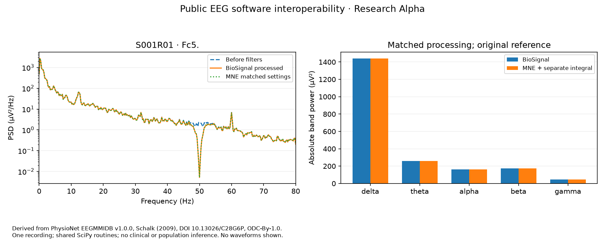

# Reproduce a public EEG analysis

An educational software-interoperability exercise, not a physiological experiment
or clinical workflow. The executable lesson is new in the adoption PR; it is not
in the immutable v0.3.0 tag. Use this checkout and record `git rev-parse HEAD`.

## Prepare this development checkout

```sh
git clone --branch adoption/student-beta-v04 https://github.com/RoyaleCoach53/biosignal-lab.git
cd biosignal-lab
python -m venv .venv
```

Install using the virtual-environment Python. On Windows use
`.\.venv\Scripts\python.exe`; on Linux/macOS use `.venv/bin/python`. The commands
below use `python` to mean that interpreter after activating the environment.

```sh
python -m pip install --upgrade pip
python -m pip install ".[tutorial]"
python tools/first_run_check.py --require-edf --output local-results/first-run.json
python examples/eeg_tutorial.py --download --cache ../biosignal-lab-data --output local-results/eeg-tutorial
```

The explicit `--download` fetches only **S001R01** from the official
[EEG Motor Movement/Imagery Database v1.0.0](https://physionet.org/content/eegmmidb/1.0.0/).
It is an eyes-open baseline. The default display uses channel index 0, retaining
its delivered label; no electrode-location inference is made. Choose another
manifest-pinned record with `--record S002R02`, or channel index with `--channel 1`.
Keep the cache outside the checkout. Cached bytes are checked against the official
SHA-256 before import; corruption fails without overwriting the cached file.

## What is calculated

| Stage | Fixed settings and interpretation |
| --- | --- |
| Import | Separate EDF digital-to-physical decoder versus MNE; 64 channels, 160 Hz, first 60 seconds, amplitudes in µV |
| Reference | Original delivered reference retained; no channel/participant exclusion or montage calibration |
| Preprocessing | Mean removal, 50 Hz notch Q=30, fourth-order 0.1 Hz high-pass, no low-pass, forward/backward filtering |
| Padding | Odd reflection; 9 samples for notch, 15 for high-pass; explicitly matched in MNE |
| Welch | Hann, four seconds/640 samples, 50% overlap/320 samples, constant segment detrending, mean averaging, density units µV²/Hz |
| Bands | Delta .5–4, theta 4–8, alpha 8–13, beta 13–30, gamma 30–45 Hz; separately integrated piecewise-linear PSD with interpolated edges, units µV² |
| Quality | Finite numerical outputs, RMS/std/median/p2p agreement plus deliberately obvious corruption controls; no expert artifact truth |

The [unchanged protocol](../benchmarks/real_world/protocol.json) defines exact
tolerances: units 1e-8 µV absolute, waveform/PSD 1e-7 relative L2, channel-band
power 1e-6 relative, rounded QC 0.000051 µV absolute. These tolerances are numerical
engineering criteria, not physiological error bars. References use volts for MNE
and convert PSD back from V²/Hz to µV²/Hz. MNE and BioSignal share SciPy routines.

## Inspect the outputs

- `spectrum-and-bands.png`: before-filter PSD, BioSignal processed PSD and matched
  MNE PSD; separately integrated band powers for the selected channel. Matching
  curves can overlap. These are derived estimates; no waveform is exported.
- `tutorial-summary.json`: recording hash, settings, versions, source revision,
  runner hash, selected band values and all-recording validation errors/controls.
  `passed` means that one recording met the declared software gates.

Expected metadata: 64 channels, 160 Hz, 60 seconds, 0.25 Hz grid. The default
S001R01 check has passed in the recorded maintainer environment; see
[executed evidence](adoption/TUTORIAL_RESULT.json). Do not use its amplitude values
as normative EEG ranges. No participant hypothesis or eyes-open/closed contrast
is being tested. This lesson is not the nine-record cohort benchmark.

That maintainer report records the executable-source commit plus `source_state`:
`modified` because documentation/evidence were being prepared. Exact runner/core
hashes are included; a base commit alone must not be treated as a clean-tree claim.
The PR's real-data CI repeats the lesson on the actual reviewed commit.



Figure derived from Schalk (2009), PhysioNet EEGMMIDB v1.0.0, DOI
[10.13026/C28G6P](https://doi.org/10.13026/C28G6P), made available under
[ODC-By-1.0](https://physionet.org/content/eegmmidb/view-license/1.0.0/).
Instrumentation: Schalk et al. (2004), BCI2000, IEEE TBME 51(6):1034–1043.
Code and synthetic fixtures are MIT; source recordings are not relicensed or
redistributed. Attribution accompanies the report/figure. See [data rights](real_world/DATA_LICENSE.md).

## Reproduce, then challenge the interpretation

Run the same command again without `--download`; it must reuse only valid cached
data. Compare record/protocol/runner hashes, configuration and numerical errors,
not OS text or generated image bytes across arbitrary Matplotlib versions.
Keep tolerances fixed. A failure is useful evidence; do not remove the record or
relax the tolerance to make it pass.

In `validation.sensitivity`, inspect native MNE padding. The original nine-file
pilot found 10.28–25.40% waveform relative L2 differences under that different
policy, still 3.89–12.97% after trimming five seconds at each edge. Neither policy
is established as physiologically correct. A five-second trim is not a general
transient-removal rule. Changing high-pass/window/notch settings changes the
measurement; it does not establish changed brain physiology.

To repeat the cohort evidence, install `.[dev,all]` and run the commands in the
[full pilot walkthrough](../examples/real_eeg_walkthrough.md). The cohort has three
participants, not 576 independent observations. Missing/corrupt/noisy controls are
software tests; human artifact sensitivity/specificity, real EMG, hardware calibration,
external qualified review and clinical validation remain unperformed.

For estimator details see the [MNE Welch API](https://mne.tools/stable/generated/mne.time_frequency.psd_array_welch.html),
[methods](METHODS.md) and [full report](real_world/REPORT.md). Report unexpected
results with the [reproduction template](../.github/ISSUE_TEMPLATE/reproducibility.yml),
sharing only redacted summaries and official IDs/hashes, never EDFs or raw headers.
