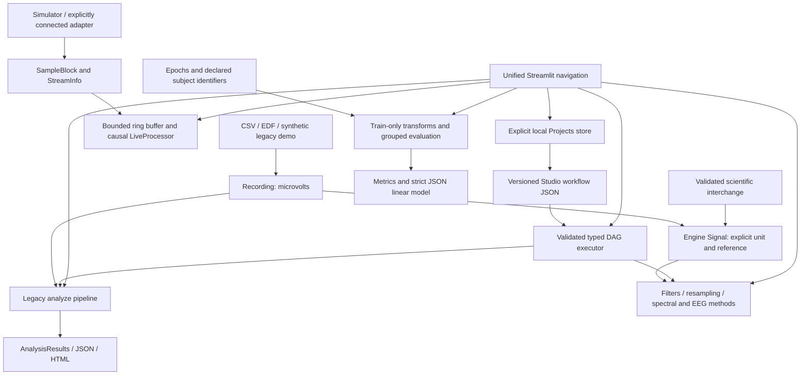

# Platform architecture and trust boundaries

The integration extends the existing package rather than replacing its validated
EEG/EMG path. Public release history and historical benchmark reports are retained.

## Data contracts

`Recording` remains channels × samples, always microvolts, with its existing
`AnalysisConfig` and `AnalysisResults` behavior. New `engine.Signal` instances
carry modality, unit, sampling rate, reference, metadata and transformation
history. Methods return new containers and preserve relevant provenance.
Dimensionless normalized values must be labeled as such.

`live.StreamInfo` declares channel-specific units and clock semantics;
`SampleBlock` binds values, timestamps and the starting sequence index. Buffer
overflow is distinct from source loss. Stateful causal filters have one owner
and must reset after a discontinuity. Optional adapter construction is explicit;
imports do not scan the network or connect devices.

Learning data bind features/epochs, targets, subject groups and provenance.
Subject-grouped outer folds assess generalization within the declared cohort;
inner grouped folds select parameters when requested. All learned transforms
belong inside training folds. Safe linear inference uses JSON coefficients;
untrusted executable model formats are not accepted.

Studio nodes have typed input/output ports, validated parameters and explicit
implementations. The executor rejects unknown nodes and cycles, checks runtime
scientific contracts, bounds outputs, and records workflow/cache provenance.
Cancellation is cooperative between nodes, not forced interruption of arbitrary
native code. Trusted custom node code can bypass in-process limits; this is not
a hostile-code sandbox. Do not auto-execute discovered entry points or imports
from workflow JSON.

## Interfaces and persistence

The existing CLI and dashboard continue to work. New workflow and AI commands
dispatch lazily, keeping optional integrations out of core startup. The unified
application hosts individual functional pages rather than implementing a second
scientific engine. The public website consumes Python-generated synthetic
scenario payloads and does not upload biomedical recordings.

The local Projects store writes immutable bounded JSON revisions using exclusive
filesystem creation. It preserves settings/workflows across application restarts.
It does not claim multi-user authorization, atomic external data acquisition,
full execution checkpoints or automatic device reconnection.

## Dependency and release boundaries

Core NumPy/SciPy/pandas dependencies remain separate from optional app, EDF,
engine, AI and acquisition extras. Release tooling verifies archive paths,
wheel RECORD hashes, source archives and SHA-256 manifests; the inventory describes
installed distribution metadata and is not a legal opinion on all native code.
Dependency advisory scans must be refreshed after dependency changes.

Any future service, plugin marketplace, automatic dataset discovery, remote
execution or multi-user hosting requires separate authentication, authorization
and resource-isolation design. Current research-only limitations remain in the
[acceptance ledger](PLATFORM_ACCEPTANCE.md).
