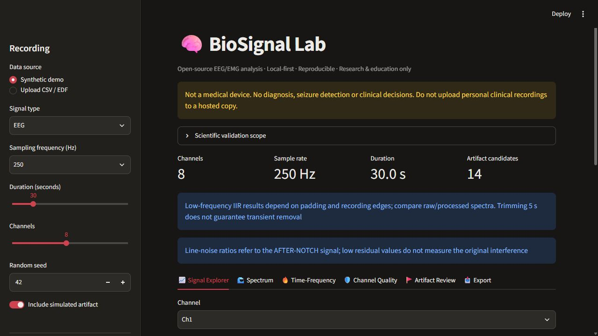
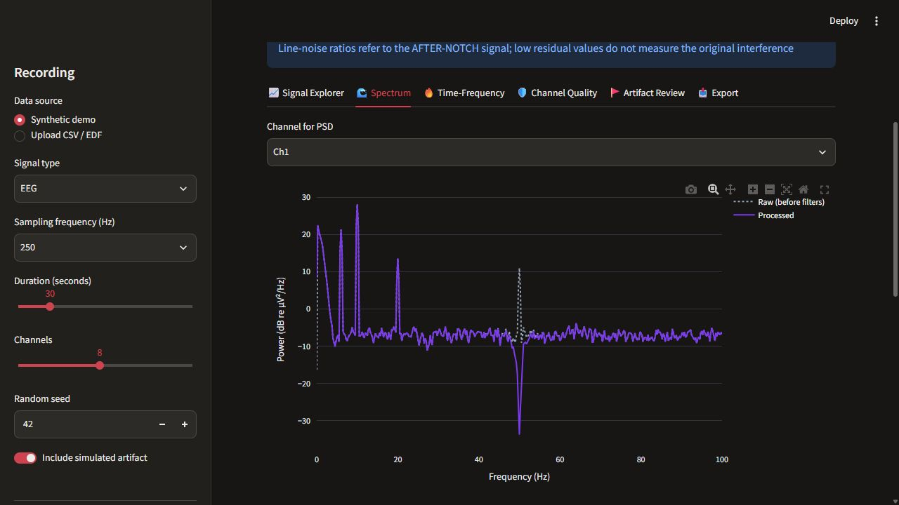

# Dashboard screenshots and provenance

Actual browser captures of the published **v0.3.0** dashboard on 2026-11-23,
using a fresh tagged clone and a new isolated Windows/Python 3.12 environment.
All signals below are synthetic: EEG, 250 Hz, 30 seconds, eight channels, seed 42,
simulated artifacts enabled. No patient data, human waveform or invented UI is shown.
The images are illustrative maintainer observations, not user testing or validation.

## First screen

Read the yellow research-only notice and blue processing notes before interpreting
results. The candidate count is heuristic, not clinical accuracy. A note appearing
on the default screen is not an installation failure.

## Spectrum

Both traces use the same four-second Welch settings. The frequency grid is
0.25 Hz; the notch changes energy near 50 Hz. This does not establish absence of
interference in the original signal. Band values below this view are in µV².

The adoption branch adds accessible descriptions where the installed Streamlit
API supports them and avoids current width-deprecation warnings. These screenshots
show the released layout; they do not certify keyboard or screen-reader usability.
Follow [Quick Start](QUICK_START.md), [the audit](adoption/INSTALLATION_AUDIT.md)
and [beta testing](beta/PROGRAM.md) for the remaining usability work.
