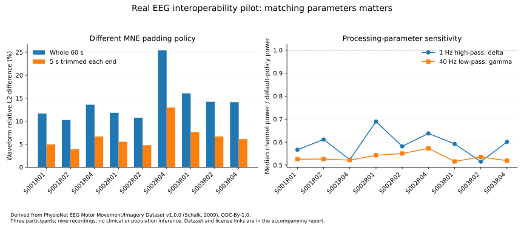

# Real EEG technical interoperability pilot — proposed v0.3.0

**Development evidence, not a published v0.3 release.** The public v0.2.0 release
is preserved. Merge and release require maintainer approval. This is an
AI-assisted software/numerical review, not independent external scientific review.

## Attribution and data rights

This report and figure contain information derived from the
[EEG Motor Movement/Imagery Dataset v1.0.0](https://physionet.org/content/eegmmidb/1.0.0/),
made available under the [ODC Attribution License v1.0](https://physionet.org/content/eegmmidb/view-license/1.0.0/).
Schalk, G. (2009), DOI [10.13026/C28G6P](https://doi.org/10.13026/C28G6P).
Original instrumentation reference: Schalk et al. (2004), BCI2000,
IEEE Transactions on Biomedical Engineering 51(6):1034–1043.
PhysioNet platform reference: Pollard et al. (2026),
[doi:10.1038/s44360-026-00096-z](https://doi.org/10.1038/s44360-026-00096-z).

The code is MIT licensed; the source recordings do not become MIT licensed.
Only derived summary statistics, checksums, and protocols are published. No EDF,
human waveform, annotation stream, or personal EDF header is included in this
repository, package, or CI artifacts. See [data rights](DATA_LICENSE.md).

## Two distinct protocols

1. **Existing six-file baseline pilot:** subjects 001–003, runs 01/02 (eyes open/
   closed), full delivered recordings, mean removal only, no digital filters,
   four-second Hann Welch and 50% overlap. Its original script was executed and
   produced six PSD-consistency passes before review fixes. It now additionally
   checks official hashes and independently decoded EDF scaling.
2. **Expanded nine-file pilot:** the same subjects, runs 01/02/04, all 64 EEG
   channels, first 60 seconds of each file at 160 Hz. Run 04 includes left/right
   fist motor imagery and rest intervals; no event-level interpretation is made.
   Default pipeline: mean removal, 50 Hz notch Q=30, fourth-order 0.1 Hz high-pass,
   no low-pass, four-second Hann Welch, 50% overlap and constant segment detrending.
   No re-reference, channel exclusion, or participant exclusion is performed.

The expanded [protocol](../../benchmarks/real_world/protocol.json) and official
[hash manifest](../../benchmarks/real_world/manifest.json) were committed in
`c3ac21a` before the first expanded analysis. This is a predeclared engineering
protocol, not an externally preregistered study. Its tolerances were not relaxed
after seeing the results. All nine files were retained, without post-hoc exclusions.

## Reference independence and comparison policy

The benchmark includes a separate, limited EDF digital-to-physical decoder,
which checks sample layout, physical/digital scaling, units, and channel order
without using the MNE EDF decoder. It handles only this uniform-rate subset;
it is not a production EDF parser or hardware calibration reference.

MNE filtering is independently configured from protocol parameters in volts.
The primary comparison explicitly matches odd-reflection padding (9 samples
for notch and 15 for high-pass), direction, order and bandwidth. MNE Welch uses
explicit Hann, FFT/segment length 640, overlap 320, mean averaging and DC removal.
PSD is converted from V²/Hz to µV²/Hz. Band integrals are independently evaluated
as piecewise-linear areas with interpolated band edges. There are 29 Welch
segments in the 60-second analysis window, on a 0.25 Hz grid.

MNE and BioSignal Lab still share SciPy numerical routines. Agreement therefore
supports technical interoperability under matched assumptions, not independently
established physiological truth, artifact accuracy, or clinical approval.

## Acceptance gates and observed results

All nine recordings passed the declared metadata, units, finite-value, PSD,
band-power and rounded channel-metric gates: **576 channel-recordings**, not
576 independent participants. The existing six-file no-filter pilot also passed.
All requested records are represented; the exception/failure list is empty.

| Quantity | Maximum observed error across nine files | Predeclared limit |
| --- | --- | --- |
| Independent EDF amplitude conversion (µV) | 1.1368684e-13 | 1e-8 µV |
| Matched-policy filtered waveform, relative L2 | 6.7734445e-13 | 1e-7 |
| Unfiltered PSD, relative L2 | 6.5100985e-16 | 1e-7 |
| Filtered PSD, relative L2 | 1.5438042e-13 | 1e-7 |
| Maximum channel/band relative error | 7.3024817e-14 | 1e-6 |
| RMS/std/median/peak-to-peak absolute difference (µV) | 4.998207e-05 | 0.000051 µV |

| Recording | Condition | Natural review candidates | Result |
| --- | --- | --- | --- |
| S001R01 | eyes_open_baseline | 43 | Pass |
| S001R02 | eyes_closed_baseline | 0 | Pass |
| S001R04 | left_right_fist_motor_imagery_run | 15 | Pass |
| S002R01 | eyes_open_baseline | 122 | Pass |
| S002R02 | eyes_closed_baseline | 1 | Pass |
| S002R04 | left_right_fist_motor_imagery_run | 102 | Pass |
| S003R01 | eyes_open_baseline | 54 | Pass |
| S003R02 | eyes_closed_baseline | 0 | Pass |
| S003R04 | left_right_fist_motor_imagery_run | 53 | Pass |

Natural candidate counts are unvalidated heuristic outputs, not expert labels or
evidence that a zero-count recording is clean. All nine recordings also passed
controlled corruption checks: an artificial one-second flatline and gross
1e6 µV burst were flagged; a three-sample NaN gap was repaired with a warning;
long and boundary gaps were rejected. These deliberately obvious perturbations
are software controls, not clinically meaningful detection sensitivity.

## Non-equivalence finding: padding matters

Letting MNE choose its native IIR padding instead of matching BioSignal Lab's
short padding produced **10.28–25.40%** waveform relative L2 differences.
Even after excluding five seconds at both ends, differences remained
**3.89–12.97%**. Those policies are **not equivalent** on these recordings.
This finding is reported as a limitation; it is not silently counted as a
reference match or corrected by adjusting tolerances. Neither policy is declared
physiologically correct by this comparison. A five-second trim is not a general
transient-removal rule for a 0.1 Hz high-pass.

Other declared sensitivity analyses cover Welch windows of 2/4/8 seconds, a
1 Hz high-pass, a 40 Hz low-pass, and no notch. Matched-policy PSD comparisons
pass at all three window lengths. Increasing the high-pass reduces median delta
power, and the 40 Hz low-pass reduces gamma power substantially. These are
processing effects, not changes in the participants' physiology. No eyes-closed
alpha direction, classification accuracy, or hypothesis-test result is required
or inferred from this convenience subset.

Machine-readable evidence: [expanded results](results.json), [baseline results](baseline-results.json),
[synthetic timing/allocation results](performance.json). Figures can be regenerated
with `benchmarks/real_world/plot_results.py`; no waveform is used by that plotter.

## Reproduce and audit

See the [educational walkthrough](../../examples/real_eeg_walkthrough.md).
The download flag is opt-in; official SHA-256 hashes are verified before decoding.
Keep the cache outside the repository. Offline runs fail closed on missing,
ambiguous or corrupted inputs. CI runs the full unit suite on Windows/Linux and
the real-data protocol on Ubuntu/Python 3.12, exporting summaries only.

The recorded environment is Python 3.12.14, MNE 1.13.2, NumPy 2.5.5 and SciPy 1.18.1.
Reports include exact versions, protocol/manifest hashes and settings. No metadata
for acquisition reference, sensor calibration or physiology is invented.

The JSON also records hashes of the benchmark and core processing source files;
the baseline report records runner/decoder hashes. These avoid reliance on a
moving branch name or a development version string for code provenance.

## Review of the three incoming research files

The incoming branch's three commits are preserved by a merge into this development
branch. The original script's six-file result was a useful narrow PSD check, but:

- A computed local hash was not compared to an official expected hash. It now is.
- Reusing the same processed array did not independently validate EDF scaling or
  preprocessing. The baseline now checks the separate decoder; the expanded
  protocol adds an explicit MNE filtering reference and separate band integration.
- A small negative PSD could pass the original absolute tolerance around zero.
  It is now rejected and covered by a regression test.
- The original download path depended on MNE's dataset/configuration API; it now
  uses the bounded, official-source, checksum-pinned opt-in downloader.
- Arbitrary subject overrides did not match the declared fixed cohort. The
  baseline runner now restricts to pinned subjects and labels partial selections.
- Cache location and exception messages could make sharing riskier. Caches are
  kept outside the checkout, and reports do not disclose local paths/header text.
- Documentation claiming results were uncollected is updated with actual evidence,
  while independent physiological/clinical validation remains explicitly unperformed.

The fixed tools are tested with synthetic numeric controls, corruption, missing
cache data, duplicate/unpinned selections, and nonpositive PSD controls. No live
recording is embedded as an automated unit-test fixture.

## Remaining scientific limits

Three non-random participants and three run conditions are not representative of
the database, patient populations, acquisition devices or diverse montages. This
is a computational case study with shared numerical dependencies. There is no
external expert review, human artifact annotation, diagnostic model, clinical
accuracy estimate, real EMG evaluation, or regulatory assessment. No general
conclusion about motor imagery or eyes-open/closed physiology is supported.
Further review must assess acquisition references, padding alternatives, channel
metadata, additional datasets and independent annotations before stronger claims.
